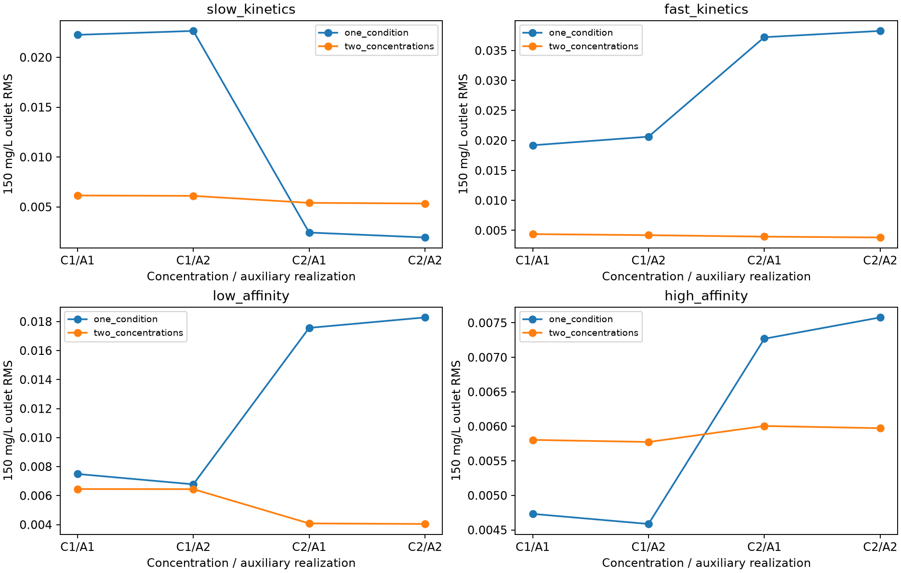

# Adsorption column: parameter estimation and measurement design

A synthetic study of a one-dimensional adsorption column (advection–dispersion with a Langmuir isotherm and linear-driving-force kinetics). The repository contains a finite-volume reference solver, inverse fits of the transport parameters, a series of measurement-design experiments, and an exploratory physics-informed neural network (PINN).

All data here are synthetic. The PINN part is unfinished: it has not yet passed its forward-solution check, so the repository does not compare PINN and classical solvers.

## Quick start

Python 3.11 or newer (the archived experiments were run on 3.14).

```bash
python -m pip install -r requirements.txt
python run_demo.py                  # forward solution at 100/150/200 mg/L
python run_demo.py --mode results   # summary of the archived experiments
python run_demo.py --mode inverse   # small, coarse inverse fit
```

The forward demo writes `generated/forward_demo.png` and a short numerical summary. The inverse demo fits a 64-cell model to noisy 256-cell synthetic data with a small optimization budget; it shows the workflow but does not reproduce the archived numbers. In Spyder you can simply open `run_demo.py` and run it.

## Model

Advection–dispersion in the pore liquid, Langmuir equilibrium and linear-driving-force uptake, with a Danckwerts inlet and a zero-gradient outlet. Equations, units and default parameters are in [docs/MODEL.md](docs/MODEL.md).

The fitted capacity parameter is **P = bulk density × saturation capacity**. Liquid-phase concentrations cannot separate these two factors in this model, and changing the flow rate or inlet concentration does not fix that.

## Main findings

- **Crossed noise pilot (36 fits).** With one true parameter set, three concentration-noise draws crossed with three porosity observations, using two inlet concentrations (20 + 20 points) instead of one (40 points) gave lower parameter errors and a lower 150 mg/L prediction error in all 9 pairings.
- **Four parameter regimes (64 fits).** Two concentrations lowered the median errors in every regime, but not in every pairing. At high affinity the prediction gain was small (about 2%).
- **Grid check.** Refitting two selected cases on a 512-cell grid did not change which design predicted better.
- **KL profile.** At high affinity the objective is clearly asymmetric around the fitted affinity, so local standard deviations should not be read as confidence intervals.
- **Porosity precision.** Making the auxiliary porosity measurement five times more precise changed the local affinity uncertainty by less than 0.2%.

More detail: [results](docs/RESULTS.md), [limitations](docs/LIMITATIONS.md), [experiment scripts](experiments/README.md).



## Experimental PINN

```bash
python -m pip install -r requirements-pinn.txt
python experimental_pinn/balanced_pinn.py --mode smoke --no-plot
```

An early-time PINN diagnostic that fine-tunes a saved checkpoint. It is not a working surrogate for the full breakthrough curve; see [experimental_pinn/README.md](experimental_pinn/README.md).

## Repository layout

| Path | Contents |
|---|---|
| `run_demo.py` | Forward, inverse and results demos |
| `physics_model.py` | Finite-volume reference solver |
| `fast_column_sensitivity.py` | Analytical parameter sensitivities with a self-check |
| `tests/` | Unit tests run in CI |
| `experiments/` | Experiment scripts, protocols and archived runs |
| `experimental_pinn/` | PINN diagnostic and checkpoint |
| `docs/` | Model, results, limitations, references |
| `SOURCE_MANIFEST.json` | SHA-256 hashes of the released source files |

## References

The column geometry and application follow Prajitno et al. (2021), [doi:10.3390/chemengineering5010009](https://doi.org/10.3390/chemengineering5010009). The Thomas-model curve rebuilt from their reported parameters is not their measured data, and no data from the paper is included here. Further methodological references are in [docs/REFERENCES.md](docs/REFERENCES.md).

## License

MIT, see [LICENSE](LICENSE).
